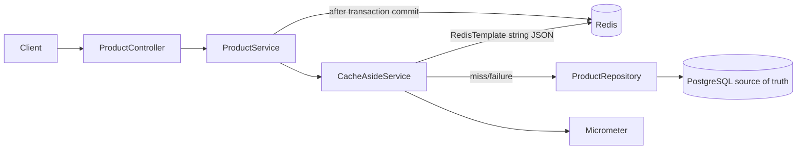
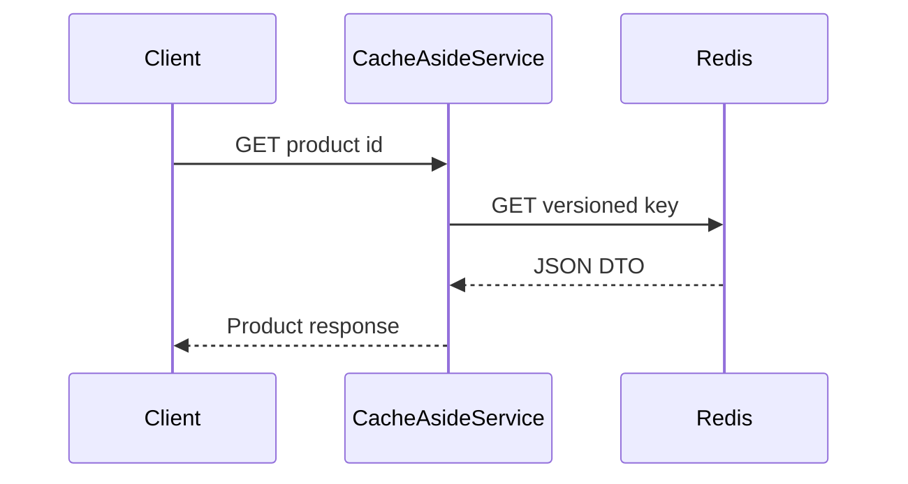
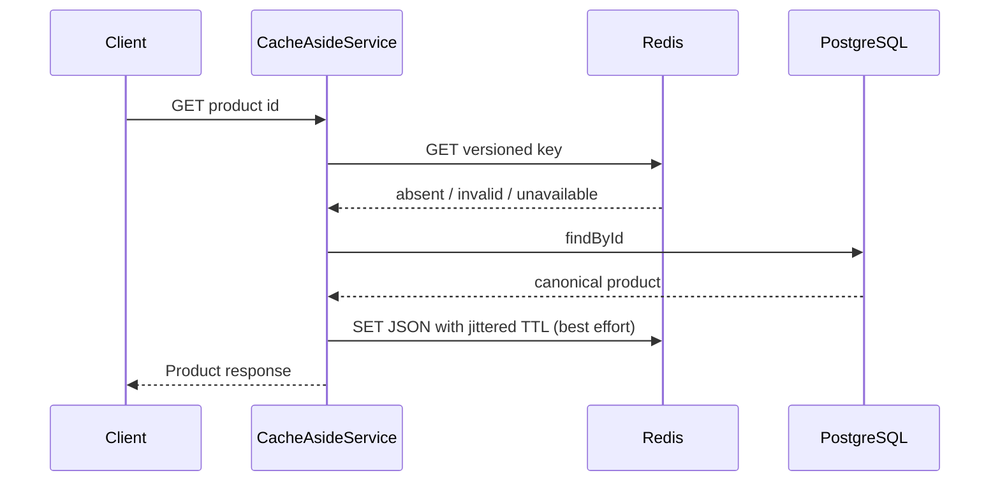
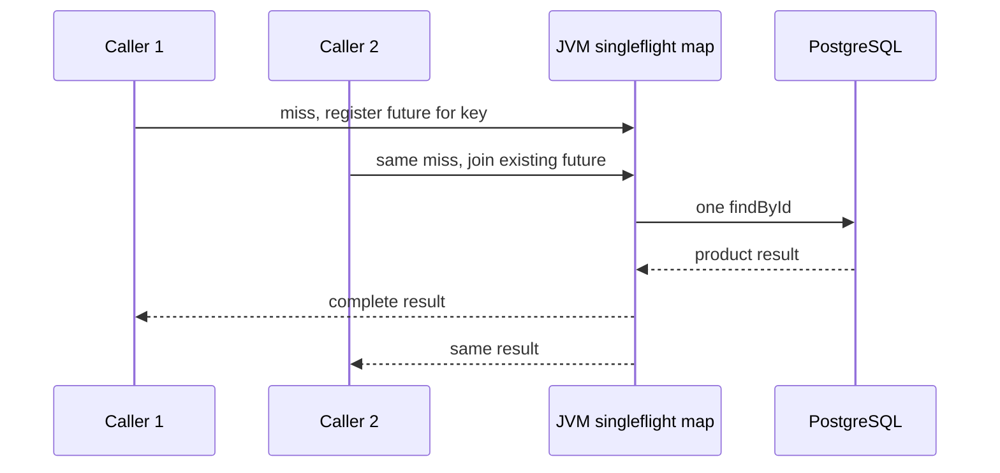

# Architecture

## Cache hit

## Cache miss

## Concurrent misses

The map coordinates callers only inside one JVM. A failure completes waiters exceptionally and removes the in-flight entry so a later request can retry. Update invalidation runs after the database commit; failed invalidation can leave stale data until TTL expiry.
